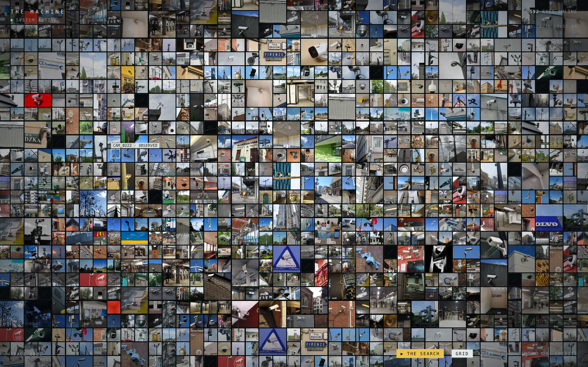

# THE MACHINE

592 张监控摄像头照片，铺成一面没有尽头的墙。点进一张照片，再穿过镜头，抵达另一只眼睛。

**[在线体验](https://the-machine-gamma.vercel.app)**



## 怎么玩

| 入口 | 体验 |
| --- | --- |
| 照片墙 | 拖动探索，滚轮或双指缩放；点击照片，点击镜头穿越 |
| ATLAS | 在世界地图上查看照片的地理分布 |
| THE SEARCH | 找到指定摄像头，或只通过镜头穿越完成每日案件 |
| TRACE | 回看自己经过的照片与路径 |
| + EYE | 加入自己的摄像头照片，填亮一个离线格子 |
| +1 OBSERVER | 自愿打开设备摄像头，让实时画面成为一个节点 |

声音默认关闭，可从底部导航开启。桌面快捷键：`H` 搜索、`A` 地图、`G` 照片墙、`T` 路径、`M` 声音、`U` 投稿、`Esc` 返回。

## 本地运行

纯静态 HTML、CSS、JavaScript，使用 Canvas 2D 渲染，无需安装依赖或构建。运行静态服务器后打开页面：

```sh
python3 -m http.server 8000
```

Vercel 使用仓库中的 `vercel.json` 直接部署静态文件。

## 照片与隐私

照片来自 Wikimedia Commons 和 Pexels，逐张署名与许可证见 [CREDITS](credits.html)。代码使用 [MIT License](LICENSE)，照片仍遵循各自许可证。

投稿照片、可选位置与排行榜仅保存在当前浏览器。摄像头画面只在设备上实时显示，不录制、不保存、不上传；再次点击观察者按钮即可关闭。

移动端已在 Chrome 触屏模拟环境检查；iOS Safari 与 Android 真机尚未验证。检查范围见 [QA](docs/QA.md)。

## English

An interactive archive of 592 photographs of surveillance cameras. Explore an infinite photo wall, travel through lenses, view the network on a world map, or follow a daily search case. Built with Canvas 2D and vanilla JavaScript, with no build step. Contributions and scores stay in the current browser; the optional webcam feed is rendered locally. Photo credits and individual licenses are listed in [CREDITS](credits.html).
